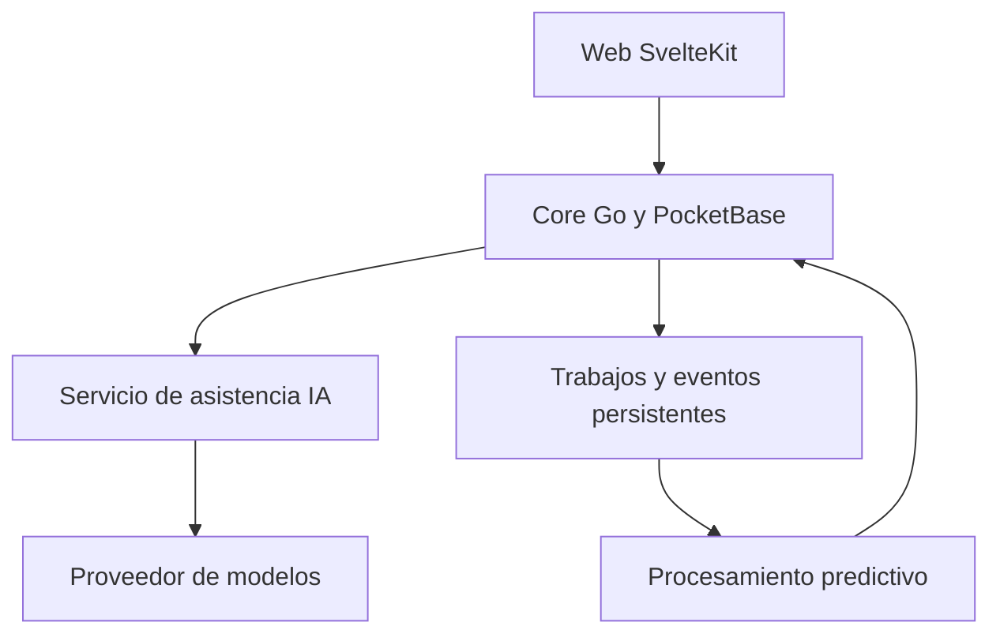

# Propuestas visionarias de inteligencia artificial para QhatuDigital Cusco

**Integrante proponente:** Johan Quispe  
**Nombre registrado en el equipo:** Johan Robinho Quispe Juarez  
**Participación:** compañero de la carrera de Ingeniería de Sistemas del propietario del repositorio.  
**Tipo de aporte:** propuesta académica de evolución arquitectónica para revisión mediante Pull Request.  
**Estado:** propuestas pendientes de discusión y aprobación; no representan funcionalidades implementadas.

## 1. Visión del aporte

Como integrante del equipo, propongo que QhatuDigital Cusco evolucione hacia una plataforma que ayude a comprar mejor, permita a los comerciantes anticipar sus necesidades y facilite la coordinación del acopio. La inteligencia artificial debe responder a problemas concretos de los mercados del Cusco y conservar el control del comprador, del vendedor y del administrador.

La visión es que una persona pueda expresar lo que necesita en lenguaje cotidiano, comparar una canasta entre mercados y recibir información útil sobre su preparación; mientras tanto, el vendedor podría recibir sugerencias de abastecimiento y apoyo para publicar sus productos. Estos avances deben incorporarse gradualmente, sin convertir la IA en una dependencia obligatoria para comprar o vender.

## 2. Punto de partida: arquitectura y estado real

Esta propuesta se basa en la revisión del commit [`497ae701760607cd2c7fe4379b6ade37a13a12e5`](https://github.com/76054175-cmd/CloudMercadoCusco/tree/497ae701760607cd2c7fe4379b6ade37a13a12e5). Se distingue entre el diseño descrito en el README y la implementación disponible.

| Componente | Evidencia en el repositorio | Implicación para las propuestas |
| --- | --- | --- |
| Aplicación web | SvelteKit, Svelte 5 y compilación estática en `apps/web/`; catálogo, comparación y carrito | Las interfaces de IA pueden integrarse en la web, con inferencia y secretos en el backend. |
| Núcleo de negocio | PocketBase como librería Go en `backend/core/` | Debe mantener la autoridad sobre permisos, catálogo, precios y operaciones transaccionales. |
| Modelo de datos | Colecciones de mercados, puestos, productos, órdenes, subórdenes, calificaciones y confianza | Tener el esquema no implica disponer de historial operativo suficiente para entrenar modelos. |
| Servicios satélite | `ms-auth-trust`, `ms-payments-qr`, `ms-logistics-dispatch` y `ms-ratings-aggregator` | Los cuatro `main.go` revisados solo registran `/health`; su lógica de negocio todavía debe desarrollarse. |
| Integraciones | El README prevé pagos, SMS y delivery simulados en la v1 | No se debe presentar una predicción como evidencia de pago, entrega o identidad verificada. |
| Configuración | Colección `app_settings` de lectura pública | Admite opciones públicas de activación; las credenciales de proveedores de IA deben mantenerse fuera de ella. |

El README marca como completadas las fases de cimientos y catálogo/carrito. Las fases de checkout, operación de vendedores, acopio y calificaciones permanecen pendientes. La aplicación móvil con Capacitor corresponde a una versión futura.

## 3. Propuestas de valor

### 3.1. Asistente de compra contextual y búsqueda semántica

**Necesidad:** encontrar productos sin depender de que el comprador conozca el nombre exacto usado en el catálogo.

**Propuesta:** permitir consultas como «busco ingredientes para una sopa para cuatro personas» y mostrar productos relacionados, con enlaces a sus puestos y mercados. El asistente puede sugerir una lista inicial que el comprador revise antes de agregarla al carrito.

**Integración:** añadir una interfaz en `apps/web/` y una ruta propuesta `POST /api/qhatu/ai/search` en el core. Un nuevo servicio opcional `ms-ai-assistant` recuperaría candidatos del catálogo mediante búsqueda semántica y generaría una explicación basada en esos resultados. Este patrón de recuperación de información antes de generar respuestas se conoce como RAG.

**Datos:** `catalog_items`, `products`, `stalls` y `markets`. Los vectores semánticos se calcularían sobre nombres y descripciones aprobadas; precios y disponibilidad se consultarían al responder, porque pueden cambiar sin que cambie el significado del producto.

**MVP:** búsqueda textual y diccionario de sinónimos como referencia; después, comparar la recuperación semántica con consultas evaluadas por el equipo. El castellano sería el punto de partida. El quechua y la entrada por voz serían extensiones sujetas a pruebas con hablantes locales y consentimiento para el tratamiento de audio.

**Límites:** el modelo no inventa productos, precios ni disponibilidad; ante información insuficiente, lo indica. Los resultados deben pasar una validación de identificadores y visibilidad. El comprador confirma cantidades y sustituciones.

**Evaluación:** relevancia de los cinco primeros resultados, proporción de respuestas fundamentadas en el catálogo, tiempo de respuesta y costo por consulta. La batería de aceptación debe rechazar cualquier respuesta que incluya productos inexistentes o precios inventados.

### 3.2. Canasta inteligente entre mercados

**Necesidad:** el producto de menor precio puede dejar de ser la mejor opción si exige recoger compras en varios mercados o pagar varias tarifas de entrega.

**Propuesta:** comparar alternativas de canasta según presupuesto, número de mercados y modalidad de entrega. Presentar opciones como «menor costo estimado» o «menos puntos de recojo», mostrando cómo se calcula cada total.

**Integración:** reutilizar el carrito en `apps/web/src/lib/cart.svelte.ts` y la relación `products.catalog_item_id`. El core validaría la propuesta antes del checkout; cuando exista la operación logística, `ms-logistics-dispatch` aportaría restricciones de entrega.

**Método:** comenzar con optimización por restricciones, sin exigir aprendizaje automático. La IA podría interpretar preferencias expresadas en texto, pero el cálculo de precios, cantidades y tarifas sería determinista. No es necesario usar un modelo generativo para sumar una canasta.

**Dependencias:** normalizar unidades y cantidades comparables; definir cómo se calculan las tarifas por mercado y modalidad. El esquema actual contiene `unit_type` y `delivery_fee`, pero no resuelve por sí solo todas las conversiones o reglas de entrega.

**Límites:** no mezclar kilogramos, unidades o presentaciones como si fueran equivalentes. No prometer un único despacho entre mercados: la arquitectura contempla órdenes por mercado. No sustituir productos ni cambiar precios pactados sin confirmación.

**Evaluación:** diferencia de costo frente a una selección manual comparable, número de mercados por canasta y porcentaje de sugerencias aceptadas. Los totales deben coincidir exactamente con el cálculo del core bajo las mismas condiciones.

### 3.3. Pronóstico de demanda y apoyo al abastecimiento

**Necesidad:** ayudar al vendedor a preparar cantidades razonables y reducir faltantes y excedentes de productos perecibles.

**Propuesta:** un panel que sugiera la demanda esperada por producto, puesto y día, con un intervalo de incertidumbre y una explicación breve de la tendencia.

**Integración:** proponer un servicio futuro `ms-demand-forecast`, ejecutado por lotes, que consuma agregados autorizados del core. El vendedor accedería únicamente a sus resultados; los indicadores del mercado requerirían permisos de administración.

**Datos disponibles y faltantes:** existen `orders`, `sub_orders` y su campo JSON `items`; será necesario definir y validar el contrato de los ítems, registrar cantidades efectivamente entregadas y conservar historia de estados. `products.in_stock` es un indicador booleano, no un inventario cuantitativo. Harían falta registros nuevos de existencias, reposición y merma para evaluar reducción de desperdicio.

**MVP:** pronóstico con promedio por día de la semana. Evaluar modelos más complejos solo cuando exista historial suficiente. Los datos de `data/seed/` sirven para demostraciones, no para demostrar precisión predictiva real.

**Límites:** no ejecutar compras ni modificar precios automáticamente. Los periodos sin stock deben distinguirse de la ausencia de demanda. Para productos nuevos se mostraría «historial insuficiente» o una referencia agregada claramente identificada.

**Evaluación:** error absoluto medio por producto y unidad, comparación con el promedio histórico y, cuando se mida, cambio en faltantes y merma. La validación debe separar cronológicamente entrenamiento y evaluación para evitar usar información del futuro.

### 3.4. Acopio predictivo y coordinación del despacho

**Necesidad:** reducir la incertidumbre sobre cuándo estarán listas todas las bolsas de una orden en la puerta principal.

**Propuesta:** estimar el tiempo restante de preparación, identificar posibles cuellos de botella y sugerir prioridades de atención al operador de acopio.

**Integración:** incorporar la capacidad en `ms-logistics-dispatch`, respetando los estados de `orders` y `sub_orders`. El core seguiría validando las transiciones; la interfaz podría recibir actualizaciones por la suscripción en tiempo real prevista en la arquitectura.

**Datos nuevos:** registrar eventos de aceptación, inicio de preparación, llegada de cada bolsa al acopio y entrega. Los campos generales `created` y `updated` no reemplazan un historial de transiciones. Para optimizar rutas también harían falta ubicaciones de origen, capacidad y disponibilidad de repartidores, además de destinos autorizados.

**MVP:** estimación basada en tiempos históricos por puesto y tamaño de pedido. Luego evaluar un modelo predictivo contra esa referencia. No se propone un optimizador de rutas completo antes de contar con datos y operación de reparto.

**Límites:** mostrar ventanas estimadas, permitir corrección del operador y conservar un orden de atención básico si el modelo falla. Una estimación nunca equivale a confirmar que una bolsa llegó ni autoriza la entrega por QR.

**Evaluación:** error de la estimación en minutos, espera en acopio y proporción de órdenes listas dentro del intervalo anunciado.

### 3.5. Copiloto de publicación para comerciantes

**Necesidad:** facilitar la publicación de productos y mantener un catálogo consistente entre puestos.

**Propuesta:** a partir de una fotografía y una breve descripción del vendedor, sugerir un nombre, una sección y una posible correspondencia con `catalog_items`.

**Integración:** interfaz futura de vendedor en `apps/web/`, validación de propietario del puesto en el core y procesamiento opcional en `ms-ai-assistant`. Solo una confirmación explícita del vendedor guardaría el producto mediante los permisos existentes.

**MVP:** sugerencia de categoría y detección de posibles duplicados. El precio, la unidad y la disponibilidad los confirma el vendedor. Para fotografías ambiguas, ofrecer varias opciones o abstenerse.

**Límites:** una imagen no permite certificar higiene, inocuidad, peso exacto ni frescura. No generar fotografías que representen como real un producto distinto. Eliminar metadatos innecesarios y evitar enviar imágenes con personas identificables al proveedor.

**Evaluación:** tiempo para publicar, porcentaje de sugerencias aceptadas sin corrección y errores de asociación al catálogo.

### 3.6. Confianza y reputación con alertas explicables

**Necesidad:** identificar incidencias y patrones atípicos sin perjudicar automáticamente a compradores o vendedores legítimos.

**Propuesta:** generar alertas revisables sobre recurrencia de ausencias, cancelaciones o variaciones anómalas en las calificaciones. Cada alerta mostraría las señales observadas y el motivo de revisión.

**Integración:** `ms-auth-trust` para señales operativas de compra y `ms-ratings-aggregator` para métricas agregadas de vendedores. Se utilizarían `trust_events`, estados de órdenes y `vendor_ratings` cuando sus flujos estén operativos.

**MVP:** reglas explícitas y resúmenes estadísticos. Evaluar detección de anomalías solo después de reunir ejemplos revisados; una anomalía no equivale a fraude. Las calificaciones actuales son un cuestionario cerrado: no se propone análisis de sentimiento sobre reseñas que no existen.

**Límites:** ninguna alerta de IA bloquearía por sí sola una cuenta ni modificaría el `trust_score`. Deben contemplarse revisión humana, corrección de errores y recuperación de confianza. No usar idioma, origen, distrito o características personales como sustitutos de confiabilidad. Compartir dispositivo no demuestra fraude.

**Evaluación:** proporción de alertas confirmadas tras revisión, falsos positivos, tiempo de resolución y correcciones solicitadas. Las puntuaciones de puestos con pocas calificaciones deben mostrar su incertidumbre y no presentarse como conclusiones firmes.

## 4. Arquitectura de integración propuesta

Todos los nombres de servicios, rutas, colecciones y eventos de esta sección son propuestas; no describen componentes ya implementados.

1. **El core aplica las reglas.** Autentica, limita frecuencia, selecciona datos autorizados y valida las respuestas antes de mostrarlas. Ningún modelo recibe acceso general a PocketBase ni puede ejecutar operaciones arbitrarias.
2. **La IA se aísla detrás de una interfaz.** El primer incremento puede añadir `backend/ms-ai-assistant/`, su módulo en `backend/go.work` y un servicio en `docker-compose.yml`. Un adaptador simulado permitiría desarrollar sin credenciales ni consumo externo.
3. **El trabajo pesado ocurre fuera de la compra.** La indexación y los pronósticos se ejecutarían en segundo plano. Inicialmente se propone una colección privada de trabajos o una bandeja de salida persistente; no se presupone que ya exista un broker de eventos.
4. **Los eventos se procesan de forma segura.** Cambios como `product.updated` u `order.completed` necesitarían un contrato versionado, identificador único, reintentos limitados e idempotencia. La publicación se registraría junto con el cambio de negocio para evitar pérdidas o duplicados con efectos repetidos.
5. **Los resultados son trazables.** Registrar versión del modelo, fecha del dato, duración, estado y motivo de abstención. Las consultas privadas no se guardarían completas por defecto; la retención se definiría por finalidad.
6. **El sistema funciona sin IA.** Ante timeout o indisponibilidad se conserva el buscador textual, el carrito normal y las reglas operativas. Los pronósticos vencidos se identifican o se ocultan.

El servicio de IA no firmaría comprobantes QR, validaría pagos ni ejecutaría reembolsos. Esas responsabilidades seguirían perteneciendo al core y a `ms-payments-qr` según sus contratos de negocio.

## 5. Contrato inicial sugerido para búsqueda

**Ruta propuesta:** `POST /api/qhatu/ai/search`. La consulta pública se limitaría al catálogo visible; una futura consulta sobre pedidos exigiría autenticación y permisos propios, sin reutilizar este acceso público.

| Elemento | Contenido y validación propuesta |
| --- | --- |
| Entrada | `query`, `market_id` opcional y `locale`; limitar longitud y validar el mercado. |
| Salida | `request_id`, `product_ids`, `explanation`, `mode` y `generated_at`. |
| Modos | `semantic`, `text_fallback` o `insufficient_data`; la interfaz debe distinguirlos. |
| Validación | Comprobar que cada producto existe, está autorizado para mostrarse y pertenece al alcance solicitado. |
| Precio y disponibilidad | Hidratarlos desde el core al responder; no confiar en cifras generadas por el modelo. |
| Fallos | Aplicar timeout y presupuesto de consumo; conservar la búsqueda textual disponible. |

Las descripciones del catálogo y las consultas del usuario se tratarían como datos no confiables: no pueden cambiar las instrucciones del servicio ni habilitar herramientas. Los identificadores devueltos por el modelo tampoco sustituyen la autorización del backend.

## 6. Hoja de ruta y criterios de avance

| Etapa | Entregable | Condición para avanzar |
| --- | --- | --- |
| 0. Aprobación y referencia | Acordar objetivos, consultas de prueba, responsables y límites de costo | Contar con criterios de aceptación y medir el buscador actual. |
| 1. Primer piloto | Búsqueda semántica de catálogo, adaptador simulado y fallback textual | Mejorar la relevancia frente a la referencia; superar pruebas de permisos, datos inventados y caída del servicio. |
| 2. Apoyo a compra y publicación | Canasta optimizada y borradores de productos revisados | Verificar unidades, totales y confirmación explícita de cambios. |
| 3. Instrumentación operativa | Checkout, acopio y calificaciones funcionales; eventos de estado fiables | Disponer de historial real y contratos estables, no únicamente datos de prueba. |
| 4. Predicción | Pilotos de demanda y tiempo de preparación | Superar referencias simples en datos posteriores al entrenamiento. |
| 5. Evolución inclusiva | Evaluación de voz, quechua y alertas de confianza | Validación con usuarios, revisión de errores y mecanismos de corrección. |

Propongo comenzar por la búsqueda semántica porque utiliza el catálogo que ya existe y permite evaluar valor sin esperar a completar todo el flujo transaccional. Los pronósticos y las alertas quedarían condicionados a la madurez de los datos.

Los umbrales de latencia, calidad y gasto deben fijarse antes del piloto, según la infraestructura y el presupuesto del equipo. Este documento no presenta porcentajes de mejora como resultados obtenidos.

## 7. Validación y operación

- **Exactitud:** consultas con sinónimos, productos inexistentes, mercados deshabilitados y cambios recientes de precio o stock.
- **Aislamiento:** comprobar que un vendedor no recibe datos privados de otro y que un comprador no accede a pedidos ajenos.
- **Resiliencia:** simular errores de proveedor, límites de consumo, índices desactualizados y eventos repetidos.
- **Evaluación humana:** compradores, vendedores y operadores revisan si la sugerencia es útil y comprensible.
- **Costo:** medir consultas, consumo por proveedor y costo por función; aplicar caché a información pública con invalidación al cambiar el catálogo.
- **Reversibilidad:** desactivar cada capacidad mediante configuración sin interrumpir catálogo, carrito o pedidos.
- **Datos mínimos:** no enviar teléfonos, direcciones, identificadores de dispositivo, tokens QR ni información de pagos a un modelo para resolver consultas de catálogo.

## 8. Alcance de este Pull Request documental

Este aporte incorpora únicamente `PROPUESTAS_IA_JOHAN_QUISPE.md`. No modifica código, migraciones, dependencias, datos de prueba ni configuración de despliegue.

**Título sugerido del PR:** `docs: propuestas de IA para QhatuDigital por Johan Quispe`.

**Descripción sugerida:** Se documentan seis propuestas de evolución con inteligencia artificial, alineadas con el core PocketBase/Go y los servicios satélite del proyecto. Se distingue el estado implementado de las capacidades futuras, y se incluyen dependencias de datos, controles, criterios de evaluación y una hoja de ruta incremental.

La incorporación debe seguir [CONTRIBUTING.md](CONTRIBUTING.md): rama `docs/`, revisión mediante Pull Request y sin cambios directos a `main`. La aprobación de este documento no equivale a aprobar proveedores, gasto, despliegues ni todos los desarrollos propuestos. Cada implementación posterior debe presentarse en un PR independiente y evaluable.

## 9. Fuentes del proyecto revisadas

- [README y arquitectura general](README.md).
- [Guía de contribución](CONTRIBUTING.md).
- [Esquema de colecciones y reglas de acceso](backend/core/migrations/1794000000_qhatu_schema.go).
- [Hooks y rutas actuales del core](backend/core/hooks/hooks.go).
- [Lectura de configuración](backend/core/settings/settings.go).
- [Utilidades del catálogo](apps/web/src/lib/catalog.ts) y [carrito](apps/web/src/lib/cart.svelte.ts).
- Servicios actuales de [confianza](backend/ms-auth-trust/main.go), [pagos y QR](backend/ms-payments-qr/main.go), [logística](backend/ms-logistics-dispatch/main.go) y [calificaciones](backend/ms-ratings-aggregator/main.go).
- [Composición del entorno de desarrollo](docker-compose.yml).

---

**Johan Quispe**  
Integrante del proyecto — Ingeniería de Sistemas
